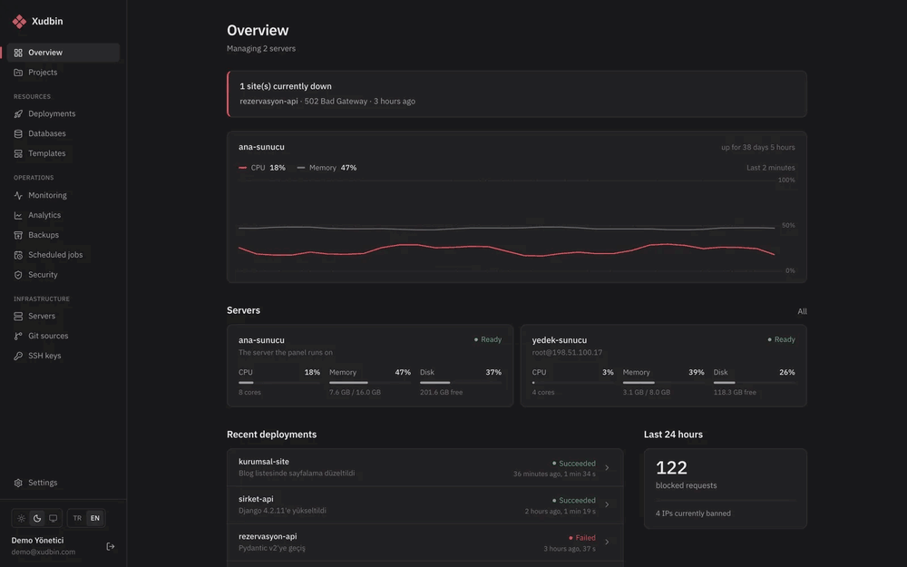

# Xudbin

**English** · [Türkçe](README.tr.md)

**[xudbin.com](https://xudbin.com/en/)** · [Live demo](https://xudbin.com/en/live-demo/) · [Docs](https://xudbin.com/en/docs/) · [Changelog](https://xudbin.com/en/changelog/) · [Security](https://xudbin.com/en/security/)



<sub>Screens from the live demo with sample data. Try it yourself: [xudbin.com/en/live-demo](https://xudbin.com/en/live-demo/) (no account needed).</sub>

Manage your servers from one panel. A self-hosted server management panel inspired by Dokploy and Coolify.
It tackles three things these panels leave out from the start:

- **An address without buying a domain:** every app automatically gets an address like `app-x7k2.1-2-3-4.sslip.io`. No DNS setup needed.
- **Free, automatic HTTPS:** Caddy obtains and renews Let's Encrypt certificates for both automatic addresses and your own domains.
- **Built-in attack protection:** WAF (Coraza + OWASP Core Rule Set), per-IP rate limiting, automatic IP bans, security headers, password protection, IP allow/deny lists and a live attack screen.

## Features

**Servers**
- The panel's own server plus unlimited remote servers connected over SSH
- An ed25519 SSH key is generated when you add a server; Docker is installed if missing and Caddy is set up
- Live CPU, memory and disk usage for all servers (remote ones included)
- One-click hardening: UFW firewall and fail2ban for SSH
- Notification when a server becomes unreachable

**Apps**
- Sources: Git repository (token for private repos), drag-and-drop upload (folder or zip), Docker image or Docker Compose
- Framework-aware deploys: the repo is scanned when you add an app and a matching framework is suggested; each framework shows its settings, required environment variables and what will happen on deploy
- Environment variables read in the code and `.env.example` can be added in one click; values such as secret keys and domains are generated automatically
- Zero-downtime deploys: traffic switches only after the new version answers a real HTTP request on its actual domain; if it returns 400/5xx, the old version stays live
- **Deploy Doctor:** explains known errors in the logs of failed deploys (Django ALLOWED_HOSTS, CSRF, missing secret key, database connection, migrations, missing packages or environment variables, out of memory) and fixes the suitable ones in one click with a redeploy
- Mandatory and domain-dependent environment variables a framework needs are added during deploy if missing; for Django, the variable names `settings.py` actually reads are detected
- Per-app memory/CPU limits; running deploys can be cancelled, with a 30-minute timeout
- After every deploy the image is scanned for known vulnerabilities with Trivy
- One-click rollback to a previous version, live deploy and app logs
- Automatic deploys from Git push webhooks (GitHub, GitLab, Gitea...) with HMAC signature verification
- **GitHub App:** created from the panel in one click; private repos deploy without entering a token, repos are picked from a list, push and PR events arrive without setting up webhooks
- **Pull request previews:** each PR gets its own address, updates on new commits and is removed when the PR closes; the address is posted as a PR comment. PRs from forks are not deployed
- **One-click templates:** WordPress, Ghost, n8n, Uptime Kuma, Vaultwarden, Gitea, Nextcloud, Metabase, Grafana, Directus, Matomo and more
- Background workers (services without a port) and multiple replicas for web apps; Caddy load-balances between replicas and takes a crashed one out of rotation
- **Multi-server load balancing:** an app can also run on additional servers; requests are spread across all replicas and an unreachable server is skipped. Traffic between servers is TLS-encrypted
- **Separate build server:** heavy builds run on another server and the finished image is transferred
- **Scheduled jobs (cron):** run commands in the app's image, with output and duration history
- Persistent volume backups: scheduled, optionally uploaded to S3, one-click restore
- Instant filtering in live logs; search across all replicas and Compose services in past logs (last hour to 14 days)
- Encrypted environment variables, persistent storage folders, CPU/memory monitoring

**Databases**
- PostgreSQL, MySQL, MariaDB, MongoDB, Redis; user and password generated automatically
- Manual or scheduled backups, retention count, download and restore
- Backups are also uploaded to S3-compatible remote storage (AWS S3, Cloudflare R2, Backblaze B2, MinIO)
- **Verified database backups:** one of the automatic database backups is regularly restored into a temporary database with no network and checked ("last backup verified, 12 tables"); volume and panel backups are not verified
- **Encrypted backups:** database and volume backups are encrypted with AES-256-GCM by default (the key is derived from the panel's `secret.key`; set up a panel backup); a downloaded backup is opened with `xudbin backup decrypt`
- **Panel backup:** the panel's own data and its encryption key are backed up encrypted; if the server is lost, `xudbin restore` brings it back on a new install

**Security**
- **Security score:** checks for the panel, servers and apps (2FA, backups, firewall, fail2ban, SSH settings, automatic updates, WAF, debug mode, image vulnerabilities...) with one-click fixes
- Docker is prevented from bypassing the firewall: from outside, containers are reachable only on 80/443, the panel's IP login (8443, can be turned off) and database ports opened from the panel
- Host access in Compose (privileged, mounting host folders, host network) requires admin approval; this check is not complete yet, so give the member role only to people you trust ([SECURITY.md](SECURITY.md))
- Per-app WAF, rate limit, security headers, password protection, IP lists
- Attack screen built from the Caddy logs of all servers: timeline, top attacking IPs, targeted addresses
- IPs over the threshold are banned automatically on all servers
- Panel: setup key, two-factor authentication (TOTP), login rate limiting, WAF on the panel address (detect-only by default; Settings > Panel WAF), CSRF protection, session management
- SSH keys, git tokens, environment variables and database passwords are encrypted with AES-256-GCM

**Traffic analytics:** cookie-free site statistics similar to Google Analytics, with no extra code. Visitors, page views, bounce rate; top pages, traffic sources (referring sites and UTM campaigns), countries, browsers, operating systems and devices. Computed from Caddy access logs on the panel's own server.

**Uptime monitoring:** every site is checked once a minute; you get notified when a site goes down and when it recovers (with the outage duration). Per-app uptime for the last 24 hours / 30 days and outage history.

**Notifications:** email (SMTP), Discord, Telegram, Slack, generic webhook. Events: site down / recovered, deploy result, critical image vulnerability, HTTPS certificate expiring, server disk or memory filling up, failed scheduled job, banned IP, failed backup, unreachable server.

**Domains:** give a server your own wildcard domain (`*.apps.mycompany.com`) and new apps get addresses under it. DNS records are checked from the panel ("this record should point to this IP"). **Cloudflare Tunnel** support for servers without open ports.

**Users and teams:** admin and member roles; members are added to projects as **developer** or **viewer** and are meant to see only those projects (the member role is not yet a strong security boundary, see [SECURITY.md](SECURITY.md)). **Single sign-on (SSO):** log in with OpenID Connect providers such as Google Workspace, Microsoft Entra, Keycloak, Authentik and GitLab. **Audit log:** who changed what and when. **API tokens:** with expiry, optionally read-only; for the `xb` command-line tool and CI/CD. New users are added with a temporary password and set their own on first login.

**Panel:** new-version notification and one-click update from the panel; time zone setting.

**Interface:** Turkish and English, light and dark theme.

## Supported frameworks

For projects without a Dockerfile, Xudbin recognizes these types and generates the Dockerfile itself (the generated Dockerfile appears in the deploy log):

| Language | Frameworks |
|---|---|
| Python | Django (Gunicorn + WhiteNoise, collectstatic/migrate on start), Flask, FastAPI, generic Python |
| JavaScript / TypeScript | Next.js (including standalone), Nuxt, SvelteKit, Astro, Remix / React Router, NestJS, React/Vue/Angular SPA, Express/Fastify/Hono, Bun, Deno |
| PHP | Laravel, generic PHP and WordPress (FrankenPHP, no Nginx needed) |
| .NET | ASP.NET Core |
| Go, Rust, Java | Go, Rust, Spring Boot (Maven/Gradle) |
| Ruby | Rails |
| Other | Static site, your own Dockerfile |

Other projects are deployed with the Dockerfile in the repo.

## Installation

On an Ubuntu, Debian or AlmaLinux/Rocky server, with ports 80 and 443 free, one command:

```bash
curl -fsSL https://raw.githubusercontent.com/Furkan1116/XudbinPanel/main/install.sh | sudo bash
```

The script does the following and shows each step in the terminal:
1. Checks the system; if RAM is under 3 GB, enables 2 GB of swap.
2. Installs Docker if it is missing.
3. Downloads Xudbin and installs the `xudbin` command.
4. Opens only SSH, 80, 443 and 8443 (the panel's IP login) in the firewall and installs fail2ban for SSH (skipped with `XUDBIN_HARDEN=0`).
5. Starts the panel: pulls the prebuilt image if available, otherwise builds from source.
6. Generates a panel address from the server's IP (`xudbin.1-2-3-4.sslip.io`) and obtains an HTTPS certificate. The panel also opens at `https://1.2.3.4:8443`; that address uses a self-signed certificate, so the browser warns on first visit (turn it off in Settings → Panel, or never open it with `XUDBIN_IP_PORT=0`).
7. Shows the **setup link** in a frame and as a QR code you can scan with your phone. The admin account can only be created with this link, so nobody can take over the setup before you once the panel is online.

## The `xudbin` command on the server

```bash
xudbin link                           # panel address (setup link on first install), with QR code
xudbin status                         # summary
xudbin user list                      # users
xudbin user create ali@example.com Ali --member   # add a user, prints a temporary password
xudbin user reset-password ali@example.com
xudbin user disable-2fa ali@example.com   # if the phone is lost
xudbin unban 203.0.113.7
sudo xudbin restore /root/xudbin-panel-....xbk   # restore a panel backup (s3://bucket/key also works)
sudo xudbin backup decrypt backup.sql.gz.xbe     # turn an encrypted database/volume backup into gzip
sudo xudbin update                    # update Xudbin, leaves your data untouched
xudbin logs                           # panel logs
```

With your own domain (its A record must point to the server):

```bash
sudo XUDBIN_DOMAIN=panel.example.com ACME_EMAIL=you@example.com ./install.sh
```

On a local network server without a public IP (home server, test machine), Let's Encrypt cannot issue certificates; install with HTTPS off:

```bash
sudo XUDBIN_HTTPS=0 ./install.sh
```

To avoid Let's Encrypt rate limits while testing certificates, you can use the staging environment (browsers don't trust these certificates; for testing only):

```bash
echo 'XUDBIN_ACME_CA=https://acme-staging-v02.api.letsencrypt.org/directory' | sudo tee -a /opt/xudbin/.env
cd /opt/xudbin && sudo docker compose up -d
```

If you miss the setup link, run `xudbin link`; the panel address is also shown on every SSH login (only to users with Docker access; to turn it off: `/etc/xudbin/no-login-link`).

## Good to know

- **Let's Encrypt:** Xudbin obtains HTTPS certificates from Let's Encrypt through Caddy. In doing so, Caddy accepts the [Let's Encrypt Subscriber Agreement](https://letsencrypt.org/repository/) on behalf of the person installing the panel.
- **Automatic addresses (sslip.io):** the `app.1-2-3-4.sslip.io` addresses given without a domain rely on a free, third-party DNS service. Let's Encrypt applies a shared weekly certificate quota to all users of that service; if the quota runs out, new automatic addresses may not get certificates for a while. Use your own domain for production sites.
- **Personal data (GDPR/KVKK):** for attack detection and traffic analytics, the panel stores the IP address, URL, browser details and referrer of requests to your apps on your own server (attack records for 30 days, analytics summaries for 400 days; for visitor counting, IPs are hashed one-way with a key that changes daily and are not stored). The person who installs the panel is the controller of this data. The panel sends no telemetry anywhere; telemetry of built Next.js, Nuxt and Astro projects is also turned off.
- **Logos:** framework logos and names are trademarks of their owners; Xudbin is not affiliated with these projects. Details: [THIRD_PARTY_NOTICES.md](THIRD_PARTY_NOTICES.md).
- **Security:** to report a vulnerability, see [SECURITY.md](SECURITY.md).

## Prebuilt images

When the repo is pushed to GitHub, `.github/workflows/ci.yml` runs the tests; if they pass, it publishes signed panel and Caddy images (amd64 + arm64, each built on its own architecture) as `ghcr.io/<owner>/xudbin` and `ghcr.io/<owner>/xudbin-caddy`. After the first publish, make both packages **Public** under GitHub > Packages; installs then use these images without building.

## Command line (xb) and CI/CD

Create a token in the panel under **Settings > Account > API tokens** (for CI, a token with an expiry that is not read-only is recommended).

```bash
sudo curl -fsSL https://raw.githubusercontent.com/Furkan1116/XudbinPanel/main/cli/xb.mjs -o /usr/local/bin/xb && sudo chmod +x /usr/local/bin/xb
xb login https://panel.example.com xb_...
xb apps                      # apps
xb deploy blog --wait        # deploy and follow the log; exit code 2 on failure
xb logs blog                 # live logs
xb rollback blog 42          # roll back to deploy #42
```

In GitHub Actions (store the token as the `XUDBIN_TOKEN` secret in the repo settings):

```yaml
- name: Deploy to Xudbin
  run: |
    curl -fsSL https://raw.githubusercontent.com/Furkan1116/XudbinPanel/main/cli/xb.mjs -o xb.mjs
    node xb.mjs deploy blog --wait
  env:
    XUDBIN_URL: https://panel.example.com
    XUDBIN_TOKEN: ${{ secrets.XUDBIN_TOKEN }}
```

You can also call the API directly: `curl -X POST -H "Authorization: Bearer xb_..." -H "Content-Type: application/json" -d '{}' https://panel.example.com/api/apps/<id>/deploy`

## Verifying images

Published images are built in GitHub Actions and signed with [Sigstore](https://www.sigstore.dev); an SBOM and provenance are published with the image. To verify the signature:

```bash
cosign verify ghcr.io/furkan1116/xudbin:1.3.2 \
  --certificate-identity-regexp '^https://github\.com/Furkan1116/XudbinPanel/\.github/workflows/' \
  --certificate-oidc-issuer https://token.actions.githubusercontent.com
```

## Adding a remote server

1. In the panel, go to **Servers > Add server**. The panel generates an SSH key for this server.
2. Run the command shown on the server to add the public key to `authorized_keys`.
3. **Test connection**, then **Start setup**. Docker and Caddy are installed automatically.

If the user is not root, it needs passwordless sudo.

## Development

Requires Node.js 22 or newer and a running Docker (on a Mac, [OrbStack](https://orbstack.dev) is recommended).

```bash
npm install
npm run dev
```

- Interface: http://localhost:5173 (Vite, proxies `/api` requests to the backend)
- API: http://localhost:3000
- On first start the setup key is printed to the terminal and kept in `apps/server/data/setup-token`.
- In development the local server starts with HTTPS off and app addresses become `*.127-0-0-1.sslip.io`; Caddy listens on port 80 on the Mac.

## Architecture

```
apps/server   Hono API (Node.js, node:sqlite, dockerode, ssh2)
apps/web      React interface (Vite, Tailwind, TanStack Query)
install.sh    One-command server install
```

- The panel connects to each server through the Docker API: via the socket on its own server, via an SSH tunnel on remote servers (`docker system dial-stdio`).
- Each server runs an `xudbin-caddy` container. The panel generates the Caddy configuration as JSON, writes it into the container and applies it with `caddy reload`.
- Each project has its own Docker network (`xb-p<id>`); single-container apps cannot reach other projects' apps and databases, or the panel itself (for Compose apps this isolation can currently be bypassed, see [SECURITY.md](SECURITY.md)). Caddy is attached to all project networks.
- In multi-server apps, the main server's Caddy connects to the additional servers' Caddy over 443; each server's internal Caddy certificate authority (CA) is read by the panel and only that one is trusted. An additional server rejects requests that don't carry the app-specific secret header.
- Caddy access logs are read every 20 seconds; WAF (403), rate limit (429), banned IP and wrong password (401) events show up on the attack screen.
- Git apps are cloned on the panel's server; the build context is sent to the target server's Docker and built there.

## Limitations

- Large-volume (L3/L4) DDoS attacks cannot be stopped at the server level; that needs your hosting provider's protection or a layer such as Cloudflare.
- Relative file mounts in Compose apps (`./data:/data`) are not supported; use named volumes.
- Multi-server deployment is for stateless apps: apps with persistent folders and Compose cannot be distributed, and replicas on additional servers cannot reach databases on the main server's internal network (expose the database and set its address accordingly). Visitors always arrive at the main server; if it goes down, the site becomes unreachable (DNS-level redundancy is out of scope).
- The GitHub App requires the panel to be reachable from the internet over https (so GitHub can send webhooks).

## License

MIT
